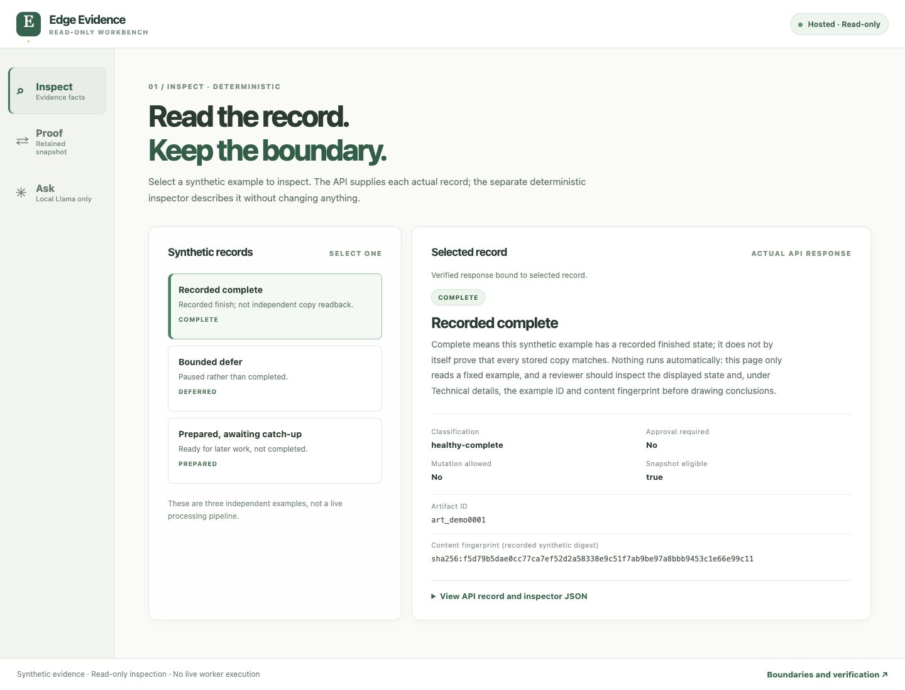

<section class="hero" aria-labelledby="home-title">
  

    
Independent engineering &amp; research

    <h1 id="home-title">Curiosity, <em>made concrete.</em></h1>
    
A space for building systems, investigating ideas, and making technical work understandable.

    
Independent engineering and research by <a href="https://github.com/Seemorghdev">Mehrdad Touraji</a>, a Python systems and platform engineer.

    
Starting with software. Making room for AI, autonomous systems, and the next good question.

    
<a class="button" href="./projects/index.md">Explore projects &nbsp;→</a><a href="#approach">How the work is approached ↓</a>

  

  <!-- Decorative static composition; reserved for a future generative visual. -->
  

  <svg viewBox="0 0 420 420" fill="none" xmlns="http://www.w3.org/2000/svg">
    <g stroke="#b8c3bd" stroke-width=".7">
      <path d="M35 105H385M35 210H385M35 315H385M105 35V385M210 35V385M315 35V385" />
      <ellipse cx="210" cy="205" rx="133" ry="149" transform="rotate(-27 210 205)" />
      <ellipse cx="210" cy="205" rx="104" ry="149" transform="rotate(-27 210 205)" />
      <ellipse cx="210" cy="205" rx="71" ry="149" transform="rotate(-27 210 205)" />
      <ellipse cx="210" cy="205" rx="35" ry="149" transform="rotate(-27 210 205)" />
      <path d="M81 273L338 140" stroke="#637a76" stroke-width="1.1" />
    </g>
    <circle cx="210" cy="205" r="4" fill="#995037" />
    <circle cx="301" cy="158" r="3" fill="#637a76" />
    <circle cx="119" cy="252" r="3" fill="#637a76" />
    <g stroke="#637a76"><path d="M33 35H43M38 30V40M377 35H387M382 30V40M33 385H43M38 380V390M377 385H387M382 380V390" /></g>
  </svg>
  
A space for explorationMehridian

</section>

<section class="section" aria-labelledby="selected-title">
  

    

01 / Selected work
<h2 id="selected-title">An experiment you can explore.</h2>

    
Start with a working demonstration. Follow the implementation, the boundaries, and the questions behind it.

  

  

    

      Software systems · Synthetic demo
      <h3><a href="./projects/edge-evidence.md">Edge Evidence</a></h3>
      
Reliable processing, verified copies, and read-only inspection. Two complementary demos make different parts of the experiment visible.

      
<a class="button" href="./projects/edge-evidence.md">Explore the case study →</a><a href="https://edge-evidence-visual-gateway-2e3eaeb86f95.herokuapp.com/">Open visual demo ↗</a>

      
Python / FastAPIProcessing + replicationPublic code

    

    
  

</section>

<section class="section" aria-labelledby="project03-title">
  

02 / Research
<h2 id="project03-title">Follow the evidence.</h2>

Project 03 is a frozen investigation of what engineering records can—and cannot—establish. Start with the story, then follow the concepts and bounded findings.

  
<a href="./research/project03/index.md">Read the Project 03 research →</a>

</section>

<section class="section" id="approach" aria-labelledby="approach-title">
  

03 / Approach
<h2 id="approach-title">Build. Observe. Share.</h2>

The implementation matters. So does being clear about what it proves—and what it does not.

  

    
01<h3>Make the question testable</h3>
Turn an idea into a small system that can be inspected and exercised.

    
02<h3>Keep the limits visible</h3>
Separate observed behavior from assumptions, synthetic examples, and future experiments.

    
03<h3>Leave a useful trail</h3>
Connect the demonstration to the code and explanations that make the work understandable.

  

</section>
