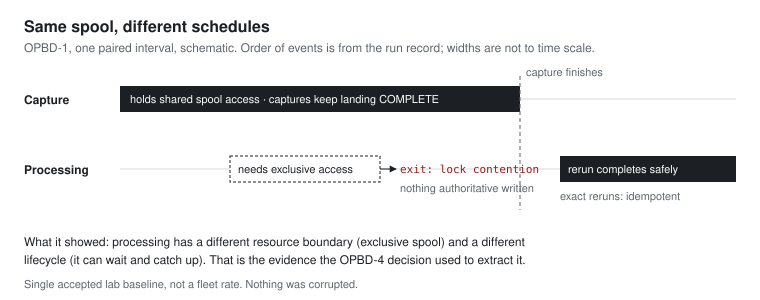

# Split out a worker after operation shows why

The first architecture diagram for a new system tends to be wrong in the same way: too many boxes. It's easy to justify a service boundary in advance. "Capture and processing are different concerns" sounds like engineering. The bill comes later: more processes to start, more state to keep consistent, more ways for a job to fail halfway between two of them.

Martin Fowler made the point a decade ago in [Monolith First](https://martinfowler.com/bliki/MonolithFirst.html). Almost every successful microservice story he'd heard started as a monolith that grew too big and was split, and almost every system built as microservices from day one had ended up in serious trouble. His reason is the interesting part: good service boundaries are hard to see in advance, and "by building a monolith first, you can figure out what the right boundaries are."

Edge Evidence was my attempt to take that advice literally, and then to ask the harder follow-up question: *how* do you figure out the right boundary? Not by waiting until it hurts. By going looking for it.

## Where it started

The early charter chose one process with explicit seams: a deterministic source, one edge-agent process, SQLite, a local spool and administrative checks. Additional workers, NAS replication, a message broker and a cloud runtime were all written down as later stages, each to be justified by "a failure, state, lifecycle or scaling boundary" before anyone built it.

That phrase was the commitment. It meant that splitting something out needed a reason I had seen, not one I could argue for.

## What the lab run showed

The first real-input baseline, OPBD-1, ran two physical sources, an iPad feed and a Surface/MediaMTX path, in paired intervals. The headline numbers were boring in the best way. Every intended capture ended `COMPLETE`, none was missing or left half-done as `PREPARED`, and a warm QNAP replica verified every eligible object. That part was expected, and it decided nothing.

The useful event was a conflict. Capture held shared access to the spool; processing needed exclusive access. Processing exited with its documented lock-contention code while capture carried on. Running processing again after capture finished gave a safe result, and repeated exact reruns stayed idempotent. Nothing was corrupted.

That's what a boundary looks like when you actually see one. Capture and processing weren't fighting over a bug. They wanted the same resource on different schedules: capture continuously, processing in bursts that need the spool to itself. And processing could clearly afford to wait. Its jobs were already durable on their own, and it caught up after a delay without losing anything. Different resource needs, different lifecycle. That's Fowler's "right boundary", found by running the thing rather than by drawing it.

## The decision, and its limits

A later decision record, OPBD-4, took OPBD-1 to OPBD-3 and answered the extraction question explicitly. Every candidate boundary got a decision, and each decision points at what had actually been observed:

| Candidate | What was observed | Decision |
| --- | --- | --- |
| Processing | Repeated capture/processing lock contention; jobs already separately durable; processing caught up successfully after a delay | **Extract** as an independent bounded worker |
| Replication | Already separate. A drill left it absent while capture continued; one catch-up run then verified 12 of 12 objects | **Keep** as its own worker |
| Capture | The record states the decision without a separate observation | **Keep** as bounded invocations |
| Event distribution | The record states the decision without a separate observation | Left optional |
| Source supervisor, operator API | No observed failure, resource or lifecycle boundary | **Defer** |
| Horizontal scale, worker fleet, broker | Not measured | Not claimed |

The bottom half of that table matters as much as the top. It would have been easy, and it would have looked more impressive, to extract a supervisor and an operator API at the same time, "while we're in there". Nothing had shown they were needed, so they waited. The record doesn't claim that a broker or a worker fleet was measured and found necessary. It names one boundary with evidence behind it and leaves the rest until they have evidence too.

## What I'd tell someone deciding the same thing

"Should this be its own service?" is a question that invites opinions. A better one is answerable: **have you actually observed a different failure, resource or lifecycle boundary here?** If you have, you can write down what you saw and point to it. If you can't point to it, you're drawing boxes.

In Edge Evidence, one lock conflict answered yes for processing, a missing-worker drill confirmed it for replication, and nothing yet justified the rest. Four of the six rows in that table are still not services. That's the part I'm most confident about.

---

*The figures come from a single accepted lab baseline and named drills, not a long-running fleet rate. The full sequence, including what the records do not establish, is in [Development and operations](https://docs.mehridian.tech/edge-evidence/development-and-operations/). See also the [Edge Evidence project](../projects/edge-evidence).*

**Further reading:** Martin Fowler, [Monolith First](https://martinfowler.com/bliki/MonolithFirst.html) (2015).
