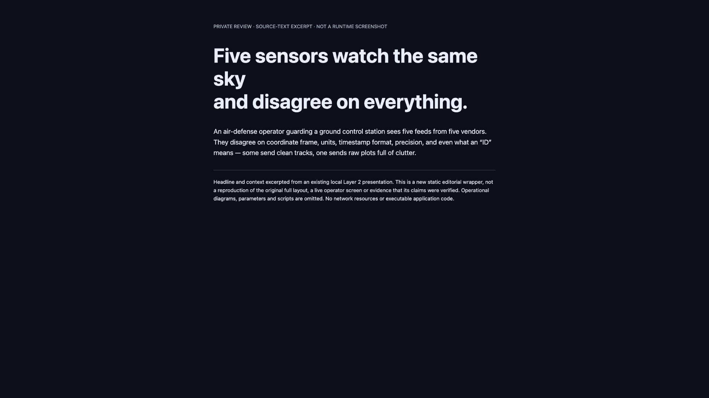

<section class="case-hero" aria-labelledby="hackathon-title">
  
Solo hackathon / Software integration

  <h1 id="hackathon-title">A common view for mismatched observations.</h1>
  
A prototype for representing observations together when their formats, units, timestamps and identifiers do not agree.

  
Solo projectPythonSynthetic scenarios

  
<a class="button" href="./common-observation-reference.md">Technical reference →</a><a href="../notes/small-evaluations.md">Read the engineering note →</a>

</section>

<nav class="showcase-jump" aria-label="Hackathon project reading path"><a href="#integration-problem">Problem</a><a href="#integration-artifacts">Artifacts</a><a href="#presentation-artifact">Screened visual</a><a href="#repository-status">Access</a></nav>

<section class="case-section" aria-labelledby="integration-problem">

01 / The problem
<h2 id="integration-problem">The inputs do not agree.</h2>

The original challenge concerned a common display for heterogeneous observations in an air-defence setting. This showcase documents the software artifacts at a high level; it does not expose the operational implementation or offer a live sensor system.

The engineering concern is easy to underestimate: similarly named fields can represent different things. A timestamp format, unit or locally assigned identifier cannot be interpreted safely without its source context.

</section>

<section class="case-section" aria-labelledby="integration-artifacts">

02 / What was produced
<h2 id="integration-artifacts">An application. A test record. An explanation.</h2>

I built the prototype as a solo hackathon project. Retained work includes the application source, a solution write-up, synthetic-scenario testing and audit summaries, and a seven-section HTML presentation.

<strong>Application</strong>Local source retained; no public runtime supplied

<strong>Scenario records</strong>Historical test declarations; not rerun here

<strong>7-section presentation</strong>Explains the approach; not an application screenshot

A synthetic vision bridge was documented separately in later work. It is not evidence of a field-camera deployment or a continuous connection to Edge Evidence.

</section>

<section class="case-section" aria-labelledby="integration-reading">

03 / Inspect the record
<h2 id="integration-reading">What a reviewer can actually inspect.</h2>

The <a href="./common-observation-reference.md">technical reference</a> inventories the retained artifacts and distinguishes the historical test units. A screened presentation-text excerpt is included below, explicitly labeled as an editorial wrapper—not the original application UI.

The <a href="https://github.com/Seemorghdev/hackathon-observation-showcase">public documentation-only showcase repository</a> contains the account, technical references and documentation screenshots. It is not an application source release or a hosted application. No reconstructed console or working-app screenshot is substituted for missing runtime evidence.

</section>

<section class="case-section" aria-labelledby="presentation-artifact">

04 / Screened explanatory visual
<h2 id="presentation-artifact">An explanation, not a console.</h2>

The retained presentation opened with “Five sensors watch the same sky and disagree on everything.” The image below is a genuine browser capture of the existing screened text wrapper—not the original seven-section layout or an application executing.
<figure><figcaption>Static editorial excerpt, captured 22 October 2026. Operational diagrams, parameters and scripts are omitted. Select the image for its full-size original. This is explanatory material; no application-runtime evidence is implied.</figcaption></figure>
The presentation helps explain the integration problem; it does not supply new runtime or field evidence. No reconstructed operator screen is included.

</section>

<section class="case-section" aria-labelledby="repository-status">

05 / Repository status
<h2 id="repository-status">Documentation you can inspect.</h2>

<a href="https://github.com/Seemorghdev/hackathon-observation-showcase">Open the public showcase repository ↗</a>. The underlying application source remains private.

Available here: project account, technical artifact inventory, historical-test limitations and a genuine screenshot of the screened text excerpt. This website does <strong>not</strong> include the operational application source, datasets, the full original presentation or a verified application-runtime screenshot.

Read the <a href="./common-observation-reference.md">technical reference</a> for the access and reproduction limits. No hosted application, application-source release or working-app demo is offered here.

</section>
