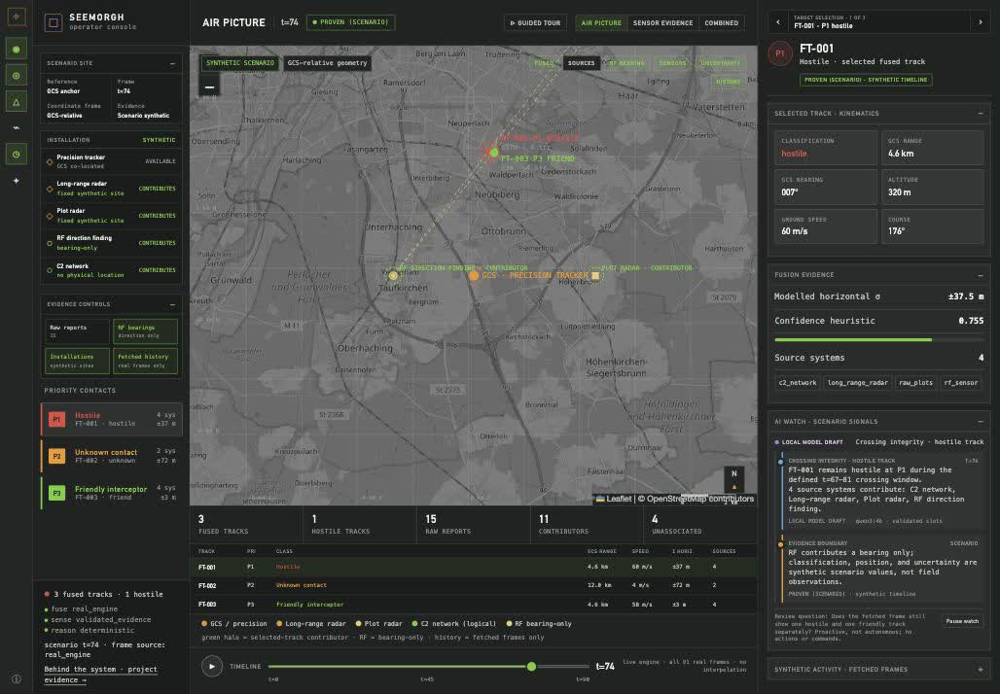
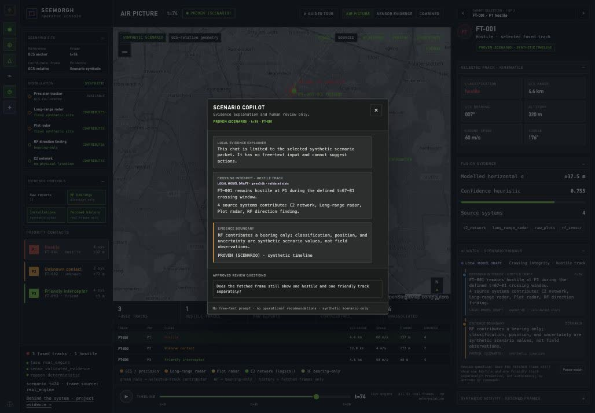
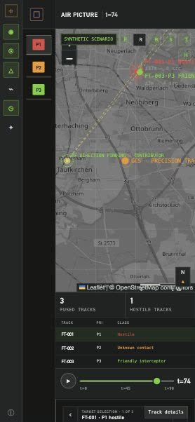
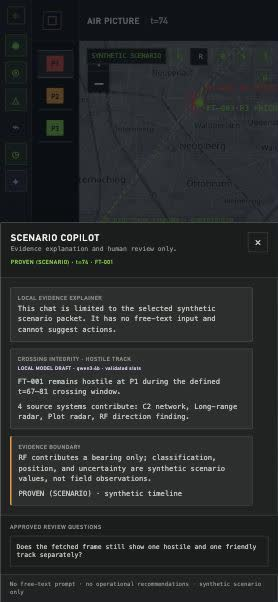

<section class="case-hero" aria-labelledby="hackathon-title">
  
Solo hackathon origin / Later application work

  <h1 id="hackathon-title">A common view for mismatched observations.</h1>
  
A map-led workspace for inspecting contradictory reports, selected-track evidence and a bounded local-model explanation.

  
Solo projectPython + JavaScriptSynthetic scenariosLocal Qwen 3 4B

  
<a class="button" href="#runtime-walkthrough">Watch the application →</a><a href="./common-observation-reference.md">Technical reference →</a>

</section>

<nav class="showcase-jump" aria-label="Hackathon project reading path"><a href="#integration-problem">Problem</a><a href="#runtime-walkthrough">Recording</a><a href="#interface-preview">Desktop + mobile</a><a href="#analyst-boundary">AI boundary</a><a href="#repository-status">Access</a></nav>

<section class="case-section" aria-labelledby="integration-problem">

01 / The problem
<h2 id="integration-problem">The inputs do not agree.</h2>

The original hackathon asked how to represent heterogeneous observations when formats, units, timestamps and identifiers disagree. I built the prototype solo. The later console makes that integration inspectable: spatial picture first, selected track second, supporting evidence third.

The runtime shown here is later follow-on work, not a screen demonstrated during the original hackathon. Every track, sensor position, classification, uncertainty value and RF bearing belongs to a deterministic synthetic scenario. The grayscale Munich basemap is a visual reference, not a field installation.

</section>

<section class="case-section" aria-labelledby="runtime-walkthrough">

02 / Watch the application
<h2 id="runtime-walkthrough">The full timeline. Actual browser frames.</h2>

<video controls preload="metadata" playsinline poster="../assets/hackathon-runtime-desktop-2026-10-24.jpg" aria-label="Recorded synthetic scenario playback from t=0 through t=90" style="display:block;width:100%;height:auto"><source src="../assets/hackathon-synthetic-timeline-2026-10-24.mp4" type="video/mp4" /><a href="../assets/hackathon-synthetic-timeline-2026-10-24.mp4">Download the recorded walkthrough</a></video>
<a href="../assets/hackathon-synthetic-timeline-2026-10-24.mp4">Download MP4 →</a>

Recorded 24 October 2026 from the running local application, using the real FUSE implementation over synthetic inputs. Browser frames were sampled approximately once per second; this is not a smooth-playback benchmark. All 91 integer frames are available from t=0–90. The separate offline adapter has only six saved bookmarks.

Playback waits for each response and does not interpolate positions. The recorded run reached t=90 in about 51 seconds; scenario time and viewing time are different. Playback currently loops and was stopped manually.

</section>

<section class="case-section" aria-labelledby="interface-preview">

03 / Desktop and mobile
<h2 id="interface-preview">Evidence stays beside the picture.</h2>

<figure><figcaption>Actual later application, synthetic crossing at t=74. AI Watch shows a validated Qwen slot selection as LOCAL MODEL DRAFT; that label does not establish verified judgment.</figcaption></figure>

Inspect the separate Copilot and mobile views
<figure><figcaption>Copilot is separate from the main dashboard and has button-only approved questions.</figcaption></figure>
<figure style="flex:1;min-width:180px"><figcaption>Mobile map-first layout. Desktop browser viewport review; physical mobile hardware was not tested.</figcaption></figure><figure style="flex:1;min-width:180px"><figcaption>The same bounded Copilot contract on the narrow layout.</figcaption></figure>

</section>

<section class="case-section" aria-labelledby="analyst-boundary">

04 / Bounded local AI
<h2 id="analyst-boundary">The model chooses what to explain.</h2>

A deterministic matcher identifies the synthetic scenario first. Qwen 3 4B chooses and orders catalog-approved explanation slots. The server validates the selected track, scenario, evidence keys and question ID. Templates supply every visible sentence; current fetched-frame values keep those facts up to date.

AI Watch shows two evidence points and a fixed evidence boundary. The separate Scenario Copilot reuses the packet for deeper inspection through approved question buttons. There is no free-text prompt and no action or recommendation path. Unavailable or invalid model output leaves a clearly labelled deterministic fallback.

Schema-valid model output demonstrates contract compliance. It does not establish verified judgment, calibrated uncertainty or field performance. RF remains bearing-only. The separate SENSE service serves retained evidence records; these captures do not demonstrate continuous camera-to-detector integration.

<a href="./common-observation-reference.md#current-acceptance">Read acceptance and limits →</a> · <a href="../notes/small-evaluations.md">Engineering note →</a>

</section>

<section class="case-section" aria-labelledby="repository-status">

05 / Access
<h2 id="repository-status">Watch publicly. Review the evidence.</h2>

<a href="https://github.com/Seemorghdev/hackathon-observation-showcase">Open the public showcase repository ↗</a>. It supplies genuine screenshots, the downloadable recording, architecture and acceptance notes. It is documentation-only; the underlying application source remains private.

Recruiters can watch or download the MP4 here, open full-size captures, and inspect the engineering evidence. There is no public interactive endpoint, model API, application-source release or installation package. Source access or a live walkthrough can be discussed with the owner; this page grants neither automatically.

The <a href="./common-observation-reference.md">technical reference</a> keeps original-event declarations, current synthetic-runtime acceptance and separate field evidence distinct. Docker image build, cloud deployment and physical mobile testing remain unverified.

</section>
