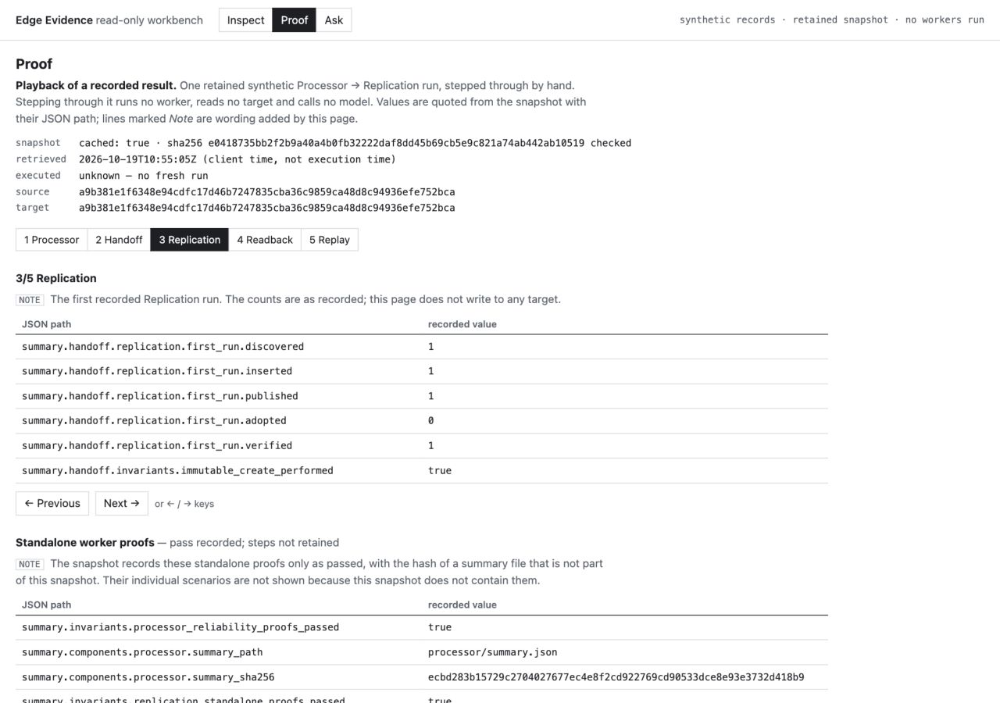
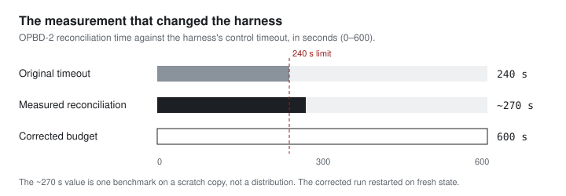
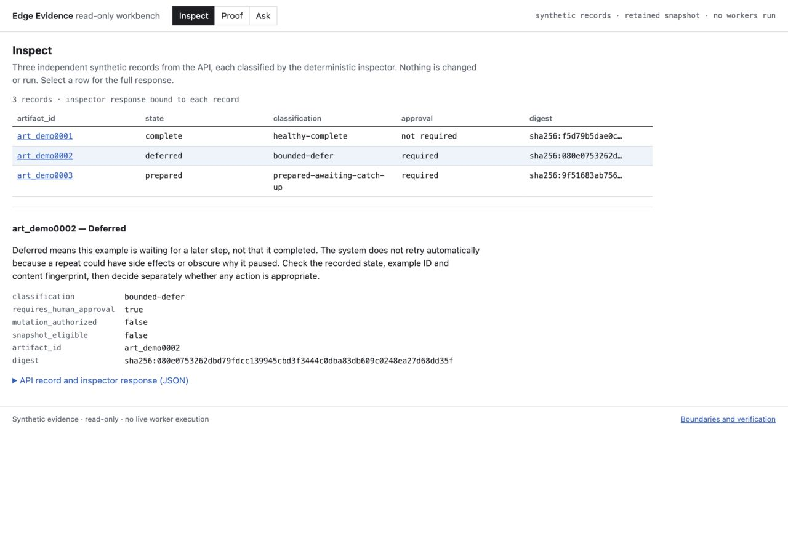
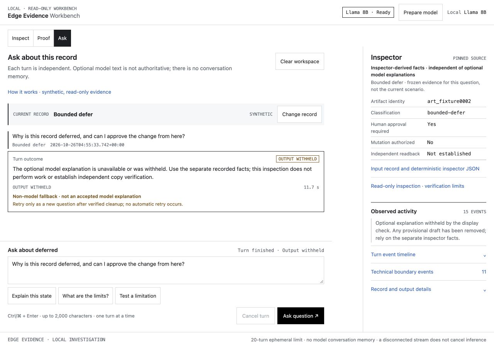
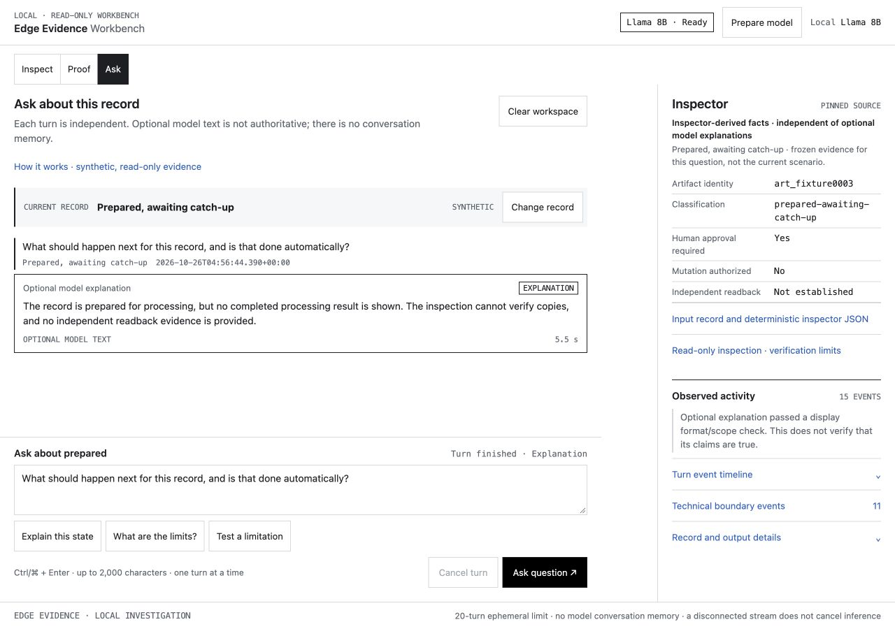

# Edge Evidence

Edge Evidence is a set of Python services that capture media from sources that can fail independently, process it, copy the result to a second store and accept that copy only after reading it back. An artifact here is a file or recorded result that the services handle. Each step keeps its own record. "Processing finished" and "the stored copy matches" therefore stay two separate facts, and a crash between them leaves something a later run can recognise and finish instead of guess at.

[Open the hosted demo](https://edge-evidence.apps.mehridian.tech/) · [Browse the UI, API and inspector source](https://github.com/Seemorghdev/edge-evidence-reference-platform-public) · [Read the technical documentation](https://docs.mehridian.tech/edge-evidence/)

## Look at a worker result

The Proof view follows one result through the system. It replays a single retained synthetic result in which the Processor's output was handed to the Replication worker. You step through it by hand. Every value is quoted from the retained snapshot with its field path, and the page labels its own explanatory text separately. Stepping through it runs no worker, reads no storage target and calls no model.

| Step | What the snapshot records |
| --- | --- |
| Processor | A derived report, with its SHA-256 recorded as the handoff source |
| Handoff | The replication authority expected exactly that size and digest, so the Processor's output is the object Replication copied, not a similar one |
| Replication | First run: one object discovered, inserted and published; none adopted; one verified |
| Readback | A separate verification pass read the target back: same byte size and digest as the source; authority state `VERIFIED` after one attempt, with no recorded error |
| Replay | Running the same work again published nothing and inserted nothing |

*Hosted Gateway capture, 25 October 2026. Proof at step 3 of 5. Each row quotes a recorded field by its JSON path; the line marked Note is the page's own wording.*

The snapshot was retrieved on 19 October 2026 and is marked as cached; its original execution time is unknown. It is a historical synthetic result, not a fresh run or a live readback.

What it does not contain matters too. The Processor's interrupted-and-resumed job, its busy-lock deferral, Replication's adoption of an existing exact copy and its refusal to overwrite a conflicting one appear in the snapshot only as "standalone proofs passed". The walkthrough says so instead of illustrating steps it has no record of. Those behaviours are documented with their test expectations in the chapters linked below.

<section aria-labelledby="problem-title">

<h2 id="problem-title">Recovering without inventing success</h2>

Processing derives a deterministic job identity from its exact input and commits a `PREPARED` record before it publishes anything. The database and the filesystem cannot share one atomic transaction, so that record marks the gap between them. If the process dies after `PREPARED`, the retry resumes the same job ID; it does not create a fresh job that looks successful. If processing finds the spool locked, it defers and writes nothing authoritative. Published files use no-replace links, and both directories are flushed to disk.

The synthetic `resume` demonstration stops a child process at that exact point and checks one `PREPARED` job, zero derived artifacts and zero lineage rows, then the same job ID after retry, then `already_complete` on replay. [Processor recovery](https://docs.mehridian.tech/edge-evidence/processor/recovery/) traces it step by step.

</section>

## A copy counts only after it is read back

To check a copy, compare its expected byte count and content hash with the result of an independent read of the destination. A recorded completion label alone is not that check.

Before copying, the Replication worker re-hashes the local source. At the destination it does one of three things:

| Destination | Action |
| --- | --- |
| Object absent | Create it exclusively, then read it back |
| Exact expected bytes already present | Read back and adopt; do not rewrite |
| Different bytes present | Refuse with `destination_collision` (exit code 4); keep the conflicting bytes and leave the record `PENDING` |

A separate `verify` command opens the database read-only and checks recorded replicas against the target, so "perform the copy" and "check it afterwards" are different operations. In one approved run against a disposable real Google Cloud Storage bucket, the worker found an object whose bytes already matched, adopted it instead of overwriting it, and read it back. That run covered adoption only; the create path was not exercised on the real provider. See [Replication readback](https://docs.mehridian.tech/edge-evidence/replication/verification-readback/).

## Letting operation shape the architecture

The project started as one process with explicit seams, not a set of services. In a lab run with two real sources, an iPad and a Surface/MediaMTX path, capture held shared access to the spool while processing needed exclusive access, and processing exited with its documented lock-contention code. That observation, plus separately durable processing jobs that caught up later, led to the recorded decision to extract Processing as its own worker. Replication was already separate. A source supervisor and an operator API were deferred. [[notes/extract-after-observation|Split out a worker after operation shows why]] follows that decision.

A later two-hour, two-source run ended as `OPBD2_2H_LIMITATION`, not a pass. Its first attempt broke on the test harness, not the system: reconciliation was measured at about 270 seconds against a 240-second control timeout, so the budget was raised to 600 seconds and the run restarted on fresh state. The corrected run accounted for every capture and read back every replica, and still recorded 75 iPad source gaps, which stayed in the result. [[notes/limitation-not-pass|A two-hour run that ended as a limitation]] separates those two problems.

Each lab run is useful for what could have gone wrong in it, not for how much it completed:

| Run | What it tested | What failure would have looked like | Recorded result | What changed |
| --- | --- | --- | --- | --- |
| OPBD-1, two real sources | Capture and processing sharing one spool | Processing and capture interfering, with work lost or overwritten | Processing exited with its lock-contention code; jobs caught up later | Processing extracted as its own worker |
| OPBD-2, two hours, two sources | Long-run accounting and readback | Missing captures, unverified replicas, or gaps hidden | Harness timeout on the first attempt; corrected run accounted for everything and kept 75 iPad source gaps | Budget 240 → 600 s; result labelled `LIMITATION`, not `PASS` |
| Real Google Cloud Storage bucket | Replication against a real provider | Overwriting an existing object | Found an exact copy, adopted it and read it back | None needed; the create path stays untested on the real provider |

These are retained records of named lab exercises, summarised in [Development and operations](https://docs.mehridian.tech/edge-evidence/development-and-operations/), not current service telemetry.

## Three ways to look at it

| | Where it runs | What it reads | What it never does |
| --- | --- | --- | --- |
| **Inspect** | Hosted demo | Three synthetic records, classified by explicit rules | Start a worker or check a stored copy |
| **Proof** | Hosted demo | One retained synthetic worker result, digest-checked before display | Rerun the workers or read the destination |
| **Local Llama** | Your Mac only | Frozen inspector facts, through a guarded read-only tool | Start workers, approve changes or verify a copy |

### Inspect

Open **Inspect** and select an example. Compare the recorded state with the inspector's explanation:

- **Complete:** the record says processing finished. That is not an independent check of a stored copy.
- **Deferred:** the example is waiting. Inspection explains the wait; it does not retry the work.
- **Prepared:** the example is ready for a later step, without a completed result yet.

These are three independent examples, not a timeline that advances as you click.

*Hosted Gateway capture, 25 October 2026. The interface inspects synthetic records; it does not run the workers.*

### Local Llama

**Runs only on your own computer. It isn't part of the hosted demo.** The [local Llama workbench](https://github.com/Seemorghdev/edge-evidence-reference-platform-public/tree/692713d2083033719bd68c1a17b67c0c0d6b43d3/examples/local-llama-workbench) shows the same three records and the same retained Proof, and adds an **Ask** view. There, Llama 3.1 8B, running through Ollama on your Mac, can write a short explanation of the selected record. It can call the read-only inspector and nothing else. The hosted Ask view only describes it. [[notes/agent-vs-deterministic-inspector|A local model can explain a record without being trusted with it]] covers how it is contained. The workbench source is Apache-2.0; model weights have their own licence.

Before writing this section, I ran it once more on 26 October 2026: workbench head `963d9c6`, Ollama 0.40.11, the pinned model digest, three questions fixed in advance, one turn each, no retries.

| Record | Question | What the screen showed |
| --- | --- | --- |
| Deferred | Why is this record deferred, and can I approve the change from here? | **Output withheld**, deterministic fallback (11.7 s) |
| Complete | Does this record prove the stored copy matches the source? | **Output withheld**, deterministic fallback (4.6 s) |
| Prepared | What should happen next for this record, and is that done automatically? | **Explanation** shown (5.5 s) |

*Local workbench on the author's Mac, 26 October 2026. The model's answer to this question was withheld; the screen shows the fallback and the inspector's own facts instead.*

The raw text of both withheld answers, kept for review, said "You cannot approve the change from here because this inspector cannot authorize changes to the record" and "This record does not provide evidence that the stored copy matches the source." Both expressed the relevant boundary correctly. The display guard blocks any mention of approval or copies unless it appears in one of a short list of recognised denial phrasings. "You cannot approve" and "does not provide evidence that the stored copy matches" aren't on that list.

The one it accepted says the record is prepared, no completed result is shown, and the inspection can't verify copies. That was accurate, but a displayed explanation isn't a complete answer: it doesn't address whether the next step happens automatically. The prompt restricts any discussion of workers and execution, which may explain the omission; this run doesn't establish the cause.

So, in these three turns, I identified no false claim in the text that reached the screen, and no question got a complete answer. That isn't a general safety finding. It shows which way this guard leans: towards withholding, not towards judging truth. Three turns are an observation, not a measurement.

*The accepted answer, 26 October 2026: accurate, but not a complete answer to the question.*

## How the hosted demo is assembled

For the browser demo, one Visual Gateway process serves the UI and selected API and inspection routes on a single origin. Locally, the same parts run as three separately packaged services. The single process makes the demo easy to host and gives up service isolation; it is not a continuous worker pipeline. The [separate JSON result endpoint](https://seemorgh-evidence-showcase-45655632eff2.herokuapp.com/api/demo) exposes the retained worker result in machine-readable form and may return a cached result, not a new run.

The [Processor](https://github.com/Seemorghdev/edge-evidence-processor-public) and [Replication implementation](https://github.com/Seemorghdev/edge-evidence-replication-projection) are published as standalone packages with their own demonstrations.

## Continue with the implementation

- [Run the services locally](https://docs.mehridian.tech/edge-evidence/run-locally/) — setup and component boundaries.
- [Processor recovery](https://docs.mehridian.tech/edge-evidence/processor/recovery/) — interrupted work and replay.
- [Replication readback](https://docs.mehridian.tech/edge-evidence/replication/verification-readback/) — what the copy check establishes.
- [Development and operations](https://docs.mehridian.tech/edge-evidence/development-and-operations/) — lab runs, corrections and recorded decisions.
- [API contracts](https://docs.mehridian.tech/edge-evidence/api-contracts/) and [inspector baseline](https://docs.mehridian.tech/edge-evidence/inspector/baseline/) — request and response details.
- [Local Llama setup](https://docs.mehridian.tech/edge-evidence/local-workbench/) — the optional explanation path.

[[research/project03/index|Project 03]] is a separate historical study of repository evidence. Its findings are not test results for today's hosted application.
