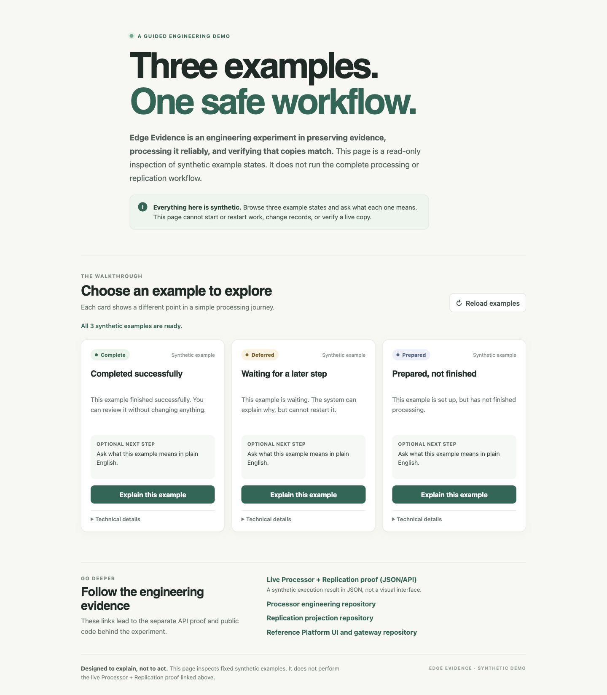

<section class="page-intro" aria-labelledby="projects-title">
  
Selected engineering experiments

  <h1 id="projects-title">Projects</h1>
  
Working systems and the questions behind them. Explore a demonstration, understand the design, and follow the work into the code.

</section>

<section class="project-list" aria-label="Project collection">
  
01 / Software systemsOne published project

  

    

      Working synthetic demonstration
      <h2><a href="./edge-evidence.md">Edge Evidence</a></h2>
      
How can you process evidence reliably and show that a copy matches its source?

      
The experiment separates processing, replication, and inspection. Its public demos offer a visual introduction and a deeper execution result.

      
<a class="button" href="./edge-evidence.md">Read the case study →</a><a href="https://edge-evidence-visual-gateway-2e3eaeb86f95.herokuapp.com/">Try the visual demo ↗</a>

      
Python / FastAPIRead-only inspectionPublic repositories

    

    
  

  
This collection starts with one real project. Future work may explore other kinds of software, AI, and autonomous systems; nothing is listed here before there is something concrete to show.

</section>
