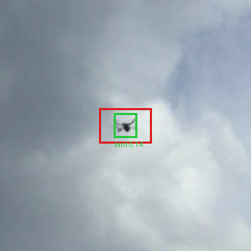
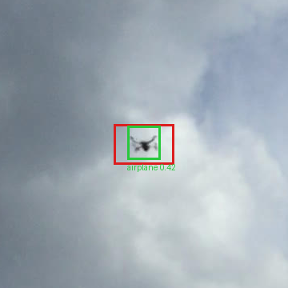

<section class="case-hero" aria-labelledby="case-title">
  
Computer vision / Offline experiment

  <h1 id="case-title">Small Objects in Big Frames</h1>
  
A drone about 40 pixels wide in a 1080 × 1920 phone frame shrinks to about 13 pixels when the whole frame is resized for a detector. This project runs the detector over overlapping crops at full resolution instead. In eight selected field frames, that scan surfaced a candidate next to the drone in every one.

  
Python / YOLO11nTiled inferencePublic weights

  
<a class="button" href="#rerun-title">See the public model run →</a><a href="./small-object-reference.md">Technical reference →</a><a href="../notes/small-evaluations.md">Read the engineering note →</a>

</section>

<nav class="showcase-jump" aria-label="Project reading path"><a href="#rerun-title">Run it yourself</a><a href="#problem-title">Problem</a><a href="#approach-title">Implementation</a><a href="#finding-title">Field observations</a><a href="#retained-outputs">Original outputs</a><a href="#recovered-model">Saved model</a><a href="#training-results">Training record</a><a href="#source-access">Source access</a></nav>

<section class="showcase-results" aria-labelledby="rerun-title">
  
New run, 27 October 2026 / Public weights, public image

  <h2 id="rerun-title">Same image, different classification.</h2>
  
I ran the released checkpoint once on the public field image, on a Mac CPU, in two ways: the whole frame resized to 640 pixels, and eight overlapping 640-pixel tiles at full resolution, with overlapping boxes merged. The settings and the reference box around the drone were fixed before the run, and the run wasn't repeated.

  <table>
    <thead><tr><th scope="col">Pass</th><th scope="col">Box on the drone</th><th scope="col">Label and confidence</th><th scope="col">Boxes elsewhere</th></tr></thead>
    <tbody>
      <tr><th scope="row">Whole frame, resized to 640 px</th><td>Yes</td><td>bird, 0.14</td><td>0</td></tr>
      <tr><th scope="row">8 overlapping 640 px tiles</th><td>Yes</td><td>airplane, 0.42</td><td>0</td></tr>
    </tbody>
  </table>
  
Both passes boxed the same object and nothing else in the frame, but they classified it differently. The whole frame called it a bird at 0.14, just above the 0.10 confidence floor. The tiles called it an airplane at 0.42. The study's evaluation notebook already counted airplane, drone and helicopter as one "aerial object" alert and bird as no alert, so under that rule only the tiled pass raises an alert.

  
That is a change in classification on one image, not proof of reliable drone recognition: neither pass labelled it a drone. The image was chosen because the drone is visible in it, and I drew the reference box by eye before the run. "Nothing else in the frame" holds for this frame only; it isn't a false-positive rate. The whole-frame time includes the model's start-up, so the two timings aren't a speed comparison.

  <figure class="showcase-capture">
    
    <figcaption>The input, as captured. This is not detector output.</figcaption>
  </figure>
  

Whole frame: bird, 0.14
<figure><figcaption>Crop of the run output around the drone. Red: the reference box drawn before the run. Green: the model's box.</figcaption></figure>

  

Tiled: airplane, 0.42
<figure><figcaption>The same crop from the tiled pass.</figcaption></figure>

  
The <a href="https://huggingface.co/Seemorgh/yolo11n-aod4-v6/tree/8d8f622270dffef4a1529443b3ec781935fb4c7c/reproduce">script, receipt, environment list and input image</a> are published next to the unchanged weights. The receipt records the hashes of the image, the checkpoint and the script, the package versions and every box. Anyone can rerun it and compare.

</section>

<section class="case-section" aria-labelledby="problem-title">
  

01 / The problem
<h2 id="problem-title">The pixels matter.</h2>

  

    
Most of a sky image is background, and the object of interest may cover a few dozen pixels of it. A detector that takes 640-pixel input has to resize a 1920-pixel frame to a third of its size, and a 40-pixel drone becomes about 13 pixels. The detail that tells a drone from a bird or a speck on the lens is what goes first.

  

</section>

<section class="case-section" aria-labelledby="approach-title">
  

02 / The prototype
<h2 id="approach-title">Examine crops. Reassemble candidates.</h2>

  

    
The prototype runs a YOLO-based detector over overlapping square crops at the frame's own resolution, maps each candidate back into the original frame and merges candidates that overlap. Nothing is resized away, at the cost of running the detector several times per frame. Whole-frame and tiled approaches were compared on a small consumer-camera field set retained for review.

  

</section>

<section class="case-section" aria-labelledby="finding-title">
  

03 / The finding
<h2 id="finding-title">Eight of eight frames. Then the hard part.</h2>

  

    
In eight selected field frames, the tiled scan returned at least one candidate next to the manually marked object in every frame. That's what the design was built to do: the object survives the scan. The comparison used the reference marks, so it shows the object wasn't lost, not that the system picked it out on its own.

    
Choosing the right candidate is a separate problem, and it's the open one. The same scans also produced competing candidates. In a separate operator-cued selection check, two of four paired observations succeeded. That's a different task and denominator, so the two results aren't added together.

    
This small, manually referenced evaluation does not establish general accuracy, autonomous selection, validated position estimates or on-phone performance.

    

      
<strong>8 of 8 selected frames</strong>
A candidate next to the manual reference in each. The reference marks were used to check.

      
<strong>2 of 4 paired observations</strong>
A separate operator-cued selection check. A different task and count.

    

  

</section>

<section class="showcase-results" aria-labelledby="retained-outputs">
  
Original evaluation images

  <h2 id="retained-outputs">What the field scans looked like.</h2>
  
These two images come from the original evaluation, unchanged. They are genuine historical image artifacts, not a live model demo. Select either image to open it full size. Their labels are the originals and aren't verified distance measurements. The outputs preserve both the manually referenced match and the competing candidates.

  

View A: a candidate beside the manual reference
<figure><figcaption>The original legend separates the reference, matched and cued markers. The match was checked against the manual reference.</figcaption></figure>

  

View B: competing candidates
<figure><figcaption>Original sideways orientation. The extra candidates over sky and trees are the selection problem, shown as it was recorded.</figcaption></figure>

</section>

<section class="case-section" aria-labelledby="recovered-model">
  

04 / Saved artifact
<h2 id="recovered-model">The checkpoint was recovered.</h2>

  

The retained <code>best.pt</code> checkpoint was recovered. Its SHA-256 exactly matches a retained model-reference record identifying it as YOLO11n, and it is the file released on Hugging Face and used in the <a href="#rerun-title">run above</a>.

A second file, <code>last.pt</code>, has a different digest, and its relationship to the training run hasn't been established. Neither model was loaded or run before the 27 October rerun, and that rerun used only <code>best.pt</code>; <code>last.pt</code> isn't released.

What else was retained?

The training and export notebook contains saved text outputs. Field-result tables and separate geometry reports also exist, including later work; they aren't presented here as a validated integrated system. No training chart or rendered detection video was found in the inspected project folders.

The <a href="./small-object-reference.md">technical reference</a> lists every artifact, what each one shows and the reproduction limits.

</section>

<section class="case-section" aria-labelledby="training-results">
  

05 / Recorded validation
<h2 id="training-results">A strong training record. Not a field score.</h2>

  

    
The retained Modal notebook records a 50-epoch run that reached <strong>mAP50 0.965</strong> and <strong>mAP50–95 0.667</strong> on <strong>4,514 validation images</strong> with 6,369 annotated objects. On its own dataset, that's a well-trained detector. The scores are averaged across four classes (airplane, bird, drone and helicopter) on the validation split, so they are not drone-specific accuracy, a held-out test result or field reliability.

    
The recovered checkpoint carries its own copy of the training history. All 200 stored metric values agree with the notebook's 50 epochs within printed rounding, with a largest difference of 0.00050. That strongly supports that the checkpoint came from this run; an original transfer receipt wasn't found.

    
The <a href="./small-object-reference.md#recorded-training-results">training results and licences</a> keep the checkpoint's stored metrics separate from the notebook's later validation scores, and explain the dataset's CC BY 4.0 declaration and the checkpoint's AGPL-3.0 notice.

  

</section>

<section class="case-section" aria-labelledby="source-access">
  

06 / Inspect the work
<h2 id="source-access">Source and reproduction.</h2>

  

The <a href="https://huggingface.co/Seemorgh/yolo11n-aod4-v6">checkpoint and model card ↗</a> are public on Hugging Face, with the <a href="https://huggingface.co/Seemorgh/yolo11n-aod4-v6/tree/8d8f622270dffef4a1529443b3ec781935fb4c7c/reproduce">run script and receipt ↗</a> from the run above. The original application remains private.

The <a href="https://github.com/Seemorghdev/drone-detection-showcase">study repository ↗</a> holds the screened original images, the technical reference and the retained-observation table.

The <a href="https://huggingface.co/Seemorgh/yolo11n-aod4-v6/blob/692377dc55f682cbe5fe17fc5944514574ca9b08/notebooks/01_train_export.ipynb">training and export notebook ↗</a> and the <a href="https://huggingface.co/Seemorgh/yolo11n-aod4-v6/blob/692377dc55f682cbe5fe17fc5944514574ca9b08/notebooks/02_eval_tiling_range.ipynb">exploratory evaluation draft ↗</a> are sanitized copies. The evaluation draft has no retained execution record and doesn't match boxes against ground truth, so its counts aren't precision, recall or false positives.

The <a href="./small-object-reference.md#public-model-and-reviewed-notebooks">technical reference</a> explains what was edited for publication and what still can't be reproduced.

</section>
