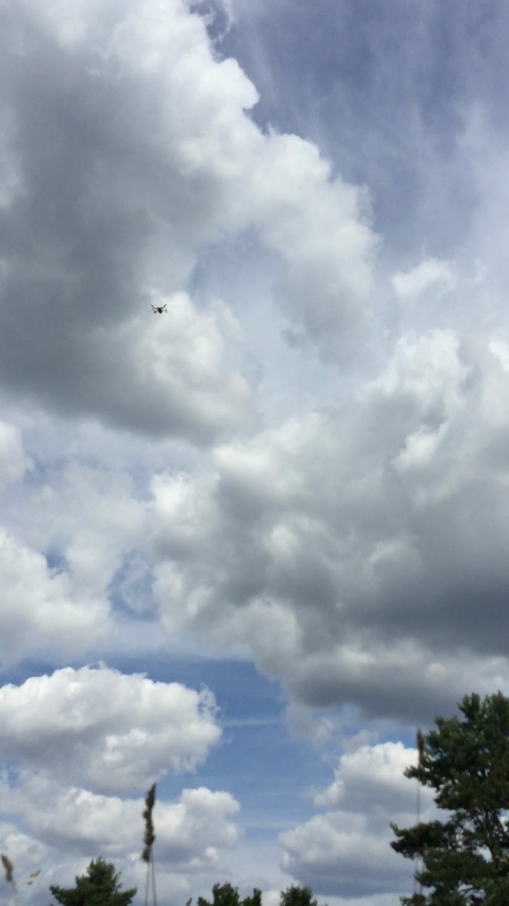
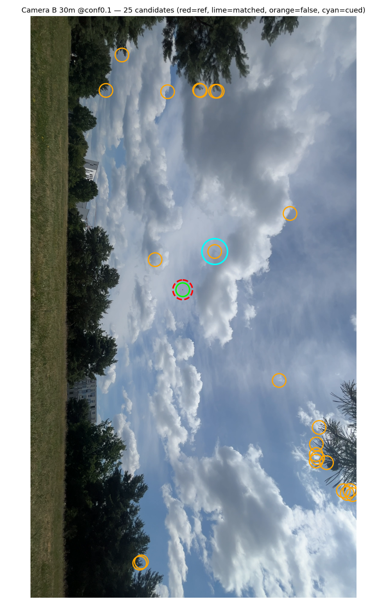

<section class="case-hero" aria-labelledby="case-title">
  
Computer vision / Offline experiment

  <h1 id="case-title">Small Objects in Big Frames</h1>
  
A tiny object can disappear when a large camera frame is reduced to fit a detector. What changes when the image is examined in smaller pieces?

  
Python / YOLOTiled inferenceConsumer-camera footage

  
<a class="button" href="./small-object-reference.md">Technical reference →</a><a href="../notes/small-evaluations.md">Read the engineering note →</a>

</section>

<figure class="showcase-capture">
  
  <figcaption>Screened field-capture input. This is not detector output. No bounding boxes, scores or positions have been added.</figcaption>
</figure>

<nav class="showcase-jump" aria-label="Project reading path"><a href="#problem-title">Problem</a><a href="#approach-title">Implementation</a><a href="#finding-title">Results</a><a href="#retained-outputs">Annotated outputs</a><a href="#recovered-model">Saved model</a><a href="#source-access">Source access</a></nav>

<section class="case-section" aria-labelledby="problem-title">
  

01 / The problem
<h2 id="problem-title">The pixels matter.</h2>

  

    
Most of a sky image is background; the object of interest may occupy only a small part of it. Shrinking the entire frame for inference can discard useful detail. This project explored how to preserve more of that detail in an offline detection workflow.

  

</section>

<section class="case-section" aria-labelledby="approach-title">
  

02 / The prototype
<h2 id="approach-title">Examine crops. Reassemble candidates.</h2>

  

    
The prototype runs a YOLO-based detector over overlapping square crops, maps the resulting candidates back into the original frame, and consolidates overlapping results. Whole-frame and tiled approaches were compared, with a small consumer-camera field set retained for review.

  

</section>

<section class="case-section" aria-labelledby="finding-title">
  

03 / The finding
<h2 id="finding-title">Finding a candidate is not choosing it.</h2>

  

    
In eight selected field frames, the tiled run returned at least one candidate near the manually marked object in each frame. The matching used those reference marks during evaluation; it was not automatic target identification.

    
The same scans produced competing candidates. In a separate operator-cued selection check, only two of four paired observations succeeded.

    
The result is a useful offline prototype, not a field-ready detection system. This small, manually referenced evaluation does not establish general accuracy, autonomous selection, validated position estimates, or live phone deployment.

    

      
<strong>8 selected frames</strong>
A reference-matched candidate was reported in each. Manual marks were used during evaluation.

      
<strong>2 of 4 paired observations</strong>
A separate operator-cued selection check succeeded in two. This is a different task and denominator.

    

  

</section>

<section class="showcase-results" aria-labelledby="retained-outputs">
  
Existing evaluation artifacts / No new inference

  <h2 id="retained-outputs">Look at the actual outputs.</h2>
  
Open either view and select the image to inspect the original at full size. The image annotations are retained as-is, including their source labels and orientation. Those labels are not independently verified distance measurements.

  

View A — a candidate beside the manual reference
<figure><figcaption>Unmodified retained output. The original legend distinguishes reference, matched and cued markers. This is a manually referenced evaluation image, not autonomous target identification.</figcaption></figure>

  

View B — competing candidates remain visible
<figure><figcaption>Unmodified retained output, with original sideways orientation. Competing candidates are part of the result, not hidden failures. A matched candidate does not mean the system selected the intended object unaided.</figcaption></figure>

  
These are genuine historical image artifacts, not a live model demo. No new overlay, score or detection has been added. The outputs preserve both the manually referenced match and the competing candidates.

</section>

<section class="case-section" aria-labelledby="recovered-model">
  

04 / Saved artifact
<h2 id="recovered-model">The checkpoint was recovered.</h2>

  

A retained <code>best.pt</code> checkpoint was recovered. Its SHA-256 exactly matches a retained model-reference record identifying it as YOLO11n. This confirms matching artifact bytes, not a fresh training result or inference acceptance.

A second <code>last.pt</code> file has a different digest. Its relationship to the training run has not been established. Neither model was loaded, converted, executed or redistributed for this showcase.

What else was retained?

The training/export notebook contains saved text outputs. Field-result tables and separate geometry reports also exist, including later work. They are not presented here as a validated integrated system. No embedded training chart or rendered detection video was located in the inspected project folders.

Read the <a href="./small-object-reference.md">technical reference</a> for artifact classes, evaluation units and reproduction limits.

</section>

<section class="case-section" aria-labelledby="source-access">
  

05 / Inspect the work
<h2 id="source-access">Source and reproduction.</h2>

  

The implementation and model weights remain private. There is no public runnable package linked here, and this page does not run inference.

The <a href="./small-object-reference.md">technical reference</a> separates the retained results from missing reproduction prerequisites. The inspectable material here is the documentation and original output imagery—not an application-source or model release.

</section>
