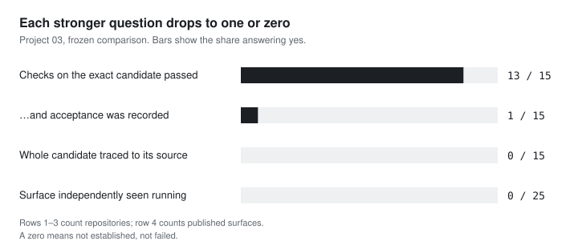

# What the records establish across 15 repositories

A lot of my code from this period was written quickly, with heavy AI assistance, and most of it had green checks. I wanted to know what I could actually show for it. So I audited my own fifteen repositories the way I would audit someone else's, asking four questions of each, each harder than the last:

1. Did the checks pass on the exact version?
2. Was that version accepted by someone with the authority to accept it?
3. Can the published copy be traced, as a whole, to the source it came from?
4. Did anyone other than me see it running?

## What made a single verdict unhelpful

The answers fell away after the first question.

| Question | Yes | Out of |
| --- | ---: | --- |
| The checks on the exact candidate passed | 13 | 15 repositories |
| …and acceptance of that candidate was recorded | 1 | 15 repositories |
| The whole candidate was traced to its exact source | 0 | 15 repositories |
| A deployed surface was independently observed running | 0 | 25 published surfaces |

Thirteen green results would have read as a healthy estate. The checks were the easy part. The evidence that lets someone else trust the software (a recorded acceptance, an exact link from published copy to source, an independent sighting of it running) only exists if someone produces it on purpose, and mostly I hadn't.

Read per repository, the drop is real rather than an artefact of separate totals. Operations, the one accepted repository, is one of the thirteen that passed:

The chapters take one question each:

- [[research/project03/verification-is-not-acceptance|Passing checks and software acceptance are different findings]]: why 13 passes became 1 acceptance, and what Operations had that the others didn't.
- [[research/project03/consumer-lab-mixed-evidence|One failed check and a 27-file provenance match]]: the one repository that shows the method catching both a failure and a positive result.
- [[research/project03/publication-and-runtime-reality|Published code is not observed runtime]]: what an independent runtime observation would have taken.
- [[research/project03/what-project-03-shows|Findings and unanswered questions]]: the findings, and ten tempting claims the records rule out.

Four short notes define the terms the chapters rely on: [[notes/candidate-verification|candidate verification]], [[notes/engineering-acceptance|engineering acceptance]], [[notes/evidence-verification|evidence verification]] and [[notes/lineage-and-provenance|lineage and provenance]].

## How the comparison was assembled

I started with three deliberately different repositories (Cohort 1): a private control, a multi-projection platform and a generated public projection with almost no history. The method was tested on those three, then applied to all 15 in-scope repositories, each with its own reviewed evidence package. An accepted evidence package means its collection was reviewed for this study. It does not mean the software was accepted or deployed.

Each question was collected separately: source identity, candidate checks, acceptance authority, publication relationships and runtime observations. Where the evidence was missing or contradictory, the record says so instead of filling the gap. The comparison and final tables are downstream views of that accepted evidence, not independent repeated measurements. Some projection observations have no stable identifier and stay unkeyed; the [[research/project03/evidence-explorer#sources-method-and-reproducibility|method reference]] covers those counting rules and the W0–W8 stages, and the [[research/project03/evidence-explorer|tables page]] has the frozen values and a downloadable extract.

## What this study can and cannot support

- **Scope.** The method was developed on the three Cohort 1 repositories. The fifteen-repository comparison is broader and descriptive; it does not extend every Cohort 1 conclusion to all fifteen.
- **Zeros are gaps, not failures.** `NOT_ESTABLISHED` means the evidence wasn't in the frozen collection. It does not mean a system broke or never ran.
- **No activity metrics.** Commit and issue counts are left out: their windows weren't aligned, and they measure activity, not quality.
- **AI is the motivation, not a finding.** The comparison can't say whether AI assistance caused any of these gaps; there's no comparison period.
- **Reproducible tables, private sources.** You can reproduce the tables from the public extract, not the private repositories behind them.

[[projects/edge-evidence|Edge Evidence]] is a separate engineering project; this frozen study did not evaluate it. It is where I build the evidence this study kept finding missing (exact identities, readback before a copy counts, recorded refusals) into the system itself.

*This is a historical schema-v1.1 comparison, not a current audit. Counts are copied from its locked final aggregate, not recomputed.*
