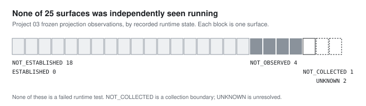

# Published code is not observed runtime

On 29 March 2024, a backdoor was disclosed in xz-utils, a compression library that, statistically, your average Linux or macOS machine has installed. It was found by Andres Freund while he was chasing down performance problems, not by any review process. The most instructive detail is where it was hidden. As the community [FAQ on the incident](https://gist.github.com/thesamesam/223949d5a074ebc3dce9ee78baad9e27) puts it, "the release tarballs upstream publishes don't have the same code that GitHub has." The code people could review in the repository and the archive distributions actually built from were not the same thing, and checking one against the other wasn't routine.

The industry's answer has been provenance: frameworks like [SLSA](https://slsa.dev/) that bind a published artifact to the exact source and build that produced it, so "this is what's in the repository" and "this is what you downloaded" can be checked rather than assumed.

The two strongest questions in Project 03 ask exactly that, of my own work. Can a published copy be traced, as a whole, to its exact source? And did anyone independently see the deployed thing running? Both came back at zero. This chapter is about what those zeros mean, because the easy readings of both are wrong.

## What was observed

Runtime is counted per published surface, not per repository: one repository published seven surfaces and another none. Across 25 accepted projection observations:

- `ESTABLISHED`: 0
- `NOT_ESTABLISHED`: 18
- `NOT_OBSERVED`: 4
- `NOT_COLLECTED`: 1
- `UNKNOWN`: 2

A positive result would have needed a retained observation of the surface running, made independently of the claim that it ran: a dated check by someone or something other than the author, kept with the record. None of the 25 has one.

The easiest wrong sentence here is "none of the systems were live." The record says something narrower and more useful: no positive independent observation was retained. `NOT_COLLECTED` marks a collection boundary and `UNKNOWN` an unresolved state; neither is a failed runtime test.

## A claim is not an observation

The historical Showcase record is `PUBLICLY_VISIBLE`, with runtime `LIVE_CLAIMED` and independent observation `NOT_ESTABLISHED`. Its reason says the documented live surface couldn't be independently observed, and explicitly warns that this isn't an observed failure.

That warning carries real weight. Without it, "I couldn't observe it" slides very easily into "it didn't work", and that's a different claim with no evidence behind it. A status page that only knows two states, up and down, would have had to pick one.

This chapter isn't a status page for today's demonstrations, and it can't certify that a claimed surface was unreachable.

## One repository can contain several different surfaces

Platform has seven projection observations: current and legacy surfaces, public and non-public ones, explicit non-claims, no-claim-found states and a live claim. A single "live / not live" label for the repository would erase all of that.

Replication's two keyed surfaces each record `EXPLICITLY_NOT_CLAIMED`, with observation `UNKNOWN` and reason `RUNTIME_DISCOVERY_INCOMPLETE`. They're kept as they are, not replaced with a portfolio-wide "no runtime claim found", because "I said this isn't live" and "I never said anything" are different statements.

## What the zero means

The lineage zero has the same shape. Relationships between repositories were recorded, and Consumer Lab proved an exact match for a declared 27-file subset. What no repository had was a binding of the *whole* published candidate to its exact source: the property SLSA-style provenance exists to give you, and the one xz's tarballs quietly lacked. The zero denies that stronger claim, not that the repositories were related. See [[research/project03/consumer-lab-mixed-evidence#relationships-subsets-and-whole-candidates|the difference between a relationship and a whole-candidate match]].

Both zeros answer a scoped question about what this study established. The runtime zero does not state that all 25 surfaces were tested and found unavailable. Neither zero describes the full historical deployment reality, still less today's. Access limits, intentionally offline surfaces, stale claims and observation methods are possible explanations, not measured causes.

What I take from them is practical. Neither kind of evidence appears by accident. A link from published copy to source exists only if the build records it. An independent sighting exists only if something other than the author goes and looks, and keeps what it saw. [[projects/edge-evidence|Edge Evidence]] is a separate engineering project, not a live monitor for these records, but it's where I build that habit into the system: a copy counts only after it has been read back.

*Research basis: the frozen schema-v1.1 comparison and the original Project 03 account. Exact private pointers stay in the internal review matrix; no source-workbook links are published. External context: [FAQ on the xz-utils backdoor (CVE-2024-3094)](https://gist.github.com/thesamesam/223949d5a074ebc3dce9ee78baad9e27); [SLSA](https://slsa.dev/) and its [build provenance specification](https://slsa.dev/spec/draft/build-provenance).*