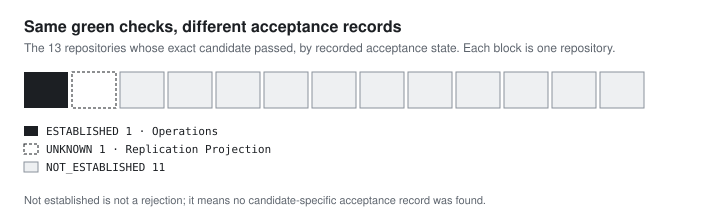

# Passing checks and software acceptance are different findings

A green check is the cheapest piece of evidence in software. A machine produces it in minutes, for free, every time someone pushes. Acceptance, meaning someone with the authority to decide recorded that *this exact version* is good enough, is the most expensive. It needs a person, a judgement and a written record.

The software industry has spent the last few years making the cheap kind cheaper. DORA's 2024 research on generative AI found that a 25% increase in AI adoption was associated with a [1.5% drop in delivery throughput and a 7.2% drop in delivery stability](https://dora.dev/ai/gen-ai-report/). Its explanation is worth reading slowly: because AI lets developers generate code much faster, batches get larger, and larger batches are "slower to review and more prone to creating system instability." The bottleneck moved from writing code to deciding whether to trust it.

My fifteen repositories show the same split, at small scale. The first was nearly universal; the second was recorded once.

## Candidate checks

A check result only counts if it's bound to a named candidate. A repository name alone doesn't say which version was checked or which result belongs to it.

In the frozen comparison, `SUCCESS_OBSERVED` means a positive check on the exact candidate was observed. `MIXED` keeps both positive and negative results. `NOT_ESTABLISHED` means no qualifying positive check was found; it isn't an observed failed test.

## Software acceptance

Acceptance needs its own candidate-specific record, and the two are easy to blur: an evidence package can be accepted *for the study* while faithfully recording that the software itself was never accepted. Reviewing the evidence and accepting the software are different acts with different purposes.

## Three recorded cases

Read per repository, the 13 passing candidates split like this:

| Of the 13 repositories whose exact candidate passed | Count | Example |
| --- | ---: | --- |
| Acceptance `ESTABLISHED` | 1 | Operations |
| Acceptance `UNKNOWN` | 1 | Replication Projection |
| Acceptance `NOT_ESTABLISHED` | 11 | Processor, among others |

This breakdown comes from per-repository recorded states: Operations, Replication Projection and the separately recorded eleven-repository pairing. It is not derived by lining up the two overall totals, which on their own don't say which repositories overlap.

The other two repositories never reached this question cleanly: Consumer Lab's checks were `MIXED`, and one repository had no qualifying check established.

- **Operations** isn't distinguished by its checks; all thirteen passed. What it has, and the others lack, is an explicit, candidate-specific review record. Someone wrote down that this version was accepted. That is one repository's record; it doesn't imply one approval policy across all fifteen.
- **Processor** passed and has no acceptance record. That isn't a rejection. Nobody decided against it; nobody decided at all, on the record.
- **Replication Projection** is `UNKNOWN`: the sources don't settle it either way. The study keeps that separate from `NOT_ESTABLISHED` instead of rounding it down, because "we can't tell" and "it isn't there" lead to different next steps.

## What the pairing does not explain

Eleven repositories passed with no acceptance on record. The pattern is clear; its cause isn't measured. Different processes, evidence that was never retained, or acceptance given somewhere outside these records are all possible.

What the drop from 13 to 1 does show is that the checks couldn't have stood in for acceptance. They looked identical on the one accepted repository and on the eleven without a record. If I had used "CI is green" as my definition of done, I would have counted thirteen finished projects. The record supports one.

That's the practical takeaway, and it's the same one DORA arrives at from the other direction: when producing code and passing checks get cheaper, the scarce, valuable step is the deliberate decision to accept it, and that decision only counts if it's written down against the exact version. The [[research/project03/evidence-explorer#engineering-acceptance|supporting table]] keeps the exact states.

*Basis: the frozen schema-v1.1 comparison and the original candidate-specific review account. No new check or acceptance decision is reported. External context: DORA, [Impact of Generative AI in Software Development](https://dora.dev/ai/gen-ai-report/) (2024).*