# Mehridian v0.6.1 reading review

This is a draft infrastructure change. No new authored pages, publication,
deployment, custom domain, or Project 03 content is included.

## What changed

- Enable native Quartz popovers, with only authored reading content in the
  `popover-hint` boundary. Header, footer, search, and graph controls stay outside.
- Give authored fragment links their destination-page context so links inside
  previews do not accidentally resolve against the reader's current page.
- Add title/opening-paragraph tooltips and 44px keyboard targets to the existing
  source-level Quartz graph adaptation. Pointer dragging and native routing remain
  in the same renderer; no additional graph library is introduced.
- Expose a header appearance button using Quartz's `saved-theme`, `theme` storage
  key, and `themechange` event. An early, blocking initialization script selects
  saved preference, otherwise system preference, otherwise warm light. The hidden
  sidebar dark-mode handler is disabled to avoid two competing toggle handlers.
- Coordinate surfaces, text, cards, search, code, previews, and graph colors in both
  themes. Existing hero geometry, animation, pause, and reduced-motion CSS remain.

## Validation performed

| Check | Result |
| --- | --- |
| Pinned production Quartz engine/configuration, Node 22 | Build passed; 5 Markdown pages |
| Unit regressions | 27 passed |
| Authored preview boundary, blocking theme initialization | Passed on all 5 pages |
| Published index and curated-content boundary | Exactly 5 existing pages; no new notes |
| Native wikilinks, backlinks, assets | Passed |
| Ordinary note and backlink hover previews | Actual note/project content; no site controls |
| Relative page links and anchored previews | Correct `/mehridian-site/` routes; anchor scroll confirmed |
| Graph pointer hover, node drag, click | Preview shown; drag retained page; click navigated |
| Graph keyboard focus, Enter, Escape | Preview, navigation and modal closing confirmed |
| Home, Projects, Notes, search and graph in both themes | Browser checked; screenshots below |
| Mobile 390px viewport | No horizontal overflow; reading/toggle/graph checked |
| Saved choice across navigation and reload | Retained |
| Text/link/accent contrast against reading background | Both palettes meet 4.5:1 |
| Controlled missing graph dependencies | Explicit fallback; links/backlinks retained |
| Controlled reduced motion and unavailable storage | Reading fallback and theme toggle remain usable |
| Normal browser console | No errors or warnings observed |
| Generated heading permalink glyphs | Hidden on pages and previews; heading IDs, anchored URLs and authored links retained |

The review follow-up fixes a selector mismatch: the pinned Quartz renderer uses
`role="anchor"`, `aria-hidden="true"`, and `data-no-popover="true"`, not an
`anchor` CSS class. Only that generated direct child of a heading is hidden.
Build regressions verify the real markup and retained targets across all five
pages. Home, mobile note and native preview screenshots were refreshed in both
themes; other screenshots show unchanged graph/search behavior from the initial
v0.6.1 verification.

Local fixtures reference existing published pages only, live in ignored preview
output, are not in the content index, and are not invoked by deployment workflows.
The review workflow builds and checks but has no deployment job or Pages permission.
The production deployment workflow is unchanged and runs only on `main` push or
explicit dispatch—not draft-PR updates.

## Publishing compatibility

The credential-free GitHub Publish per-site YAML override was synchronized with
the repository configuration. The repository-local theme remains the configured
plugin source; no installed/generated Quartz code is patched. `Public/site/` and
all five authored pages are unchanged. Do not invoke GitHub Publish while this PR
is pending, because it could publish the locally staged configuration before review.

## Review limitations

- Mobile is a browser viewport check, not a physical-phone touch or screen-reader
  certification. Navigation does not depend on hovering; ordinary links and
  backlinks remain the accessible alternative.
- Reduced motion/storage failures were exercised with local controlled fixtures,
  plus source tests; the operating system's preferences were not changed.
- Early theme initialization is structurally before first paint. No filmed
  first-paint benchmark or guarantee of zero flash in every browser is claimed.
- Native text popovers remain Quartz hover previews. Graph previews also work on
  keyboard focus. Graph libraries remain opt-in and locally pinned (approximately
  318KB gzip combined), unchanged from v0.6.

## Screenshots

### Desktop

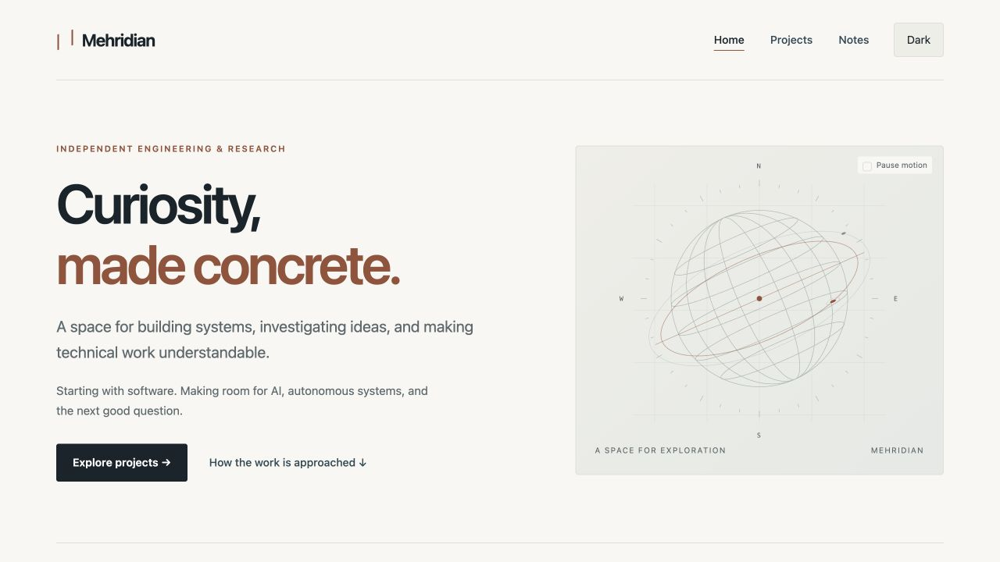
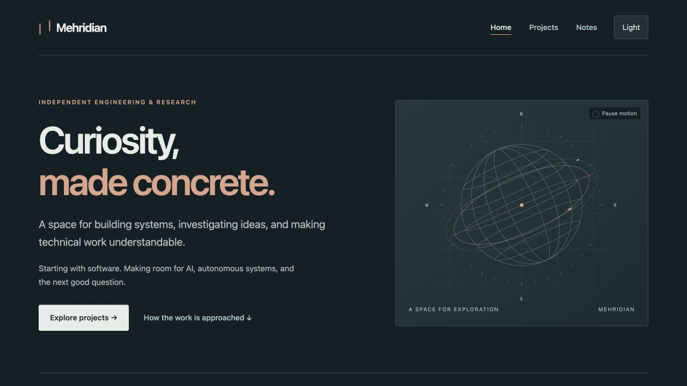
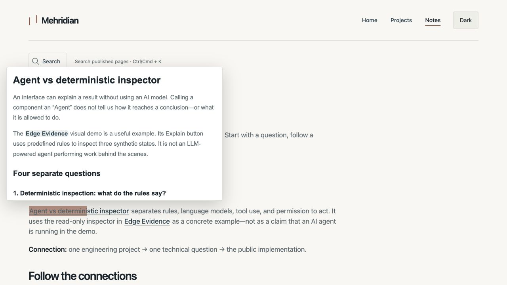
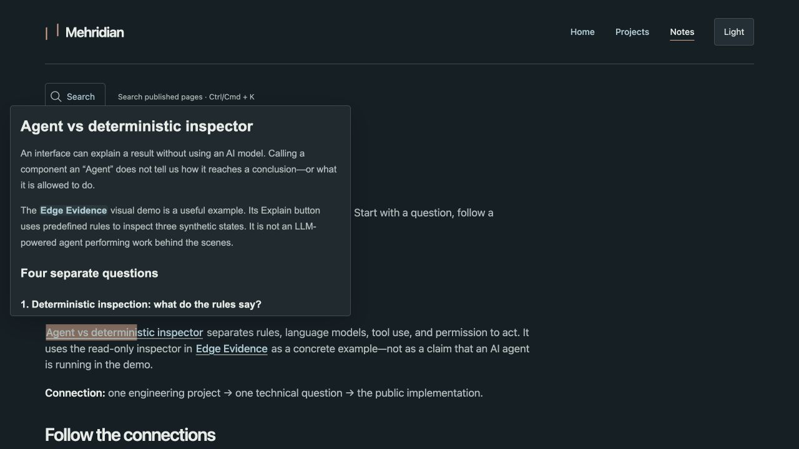
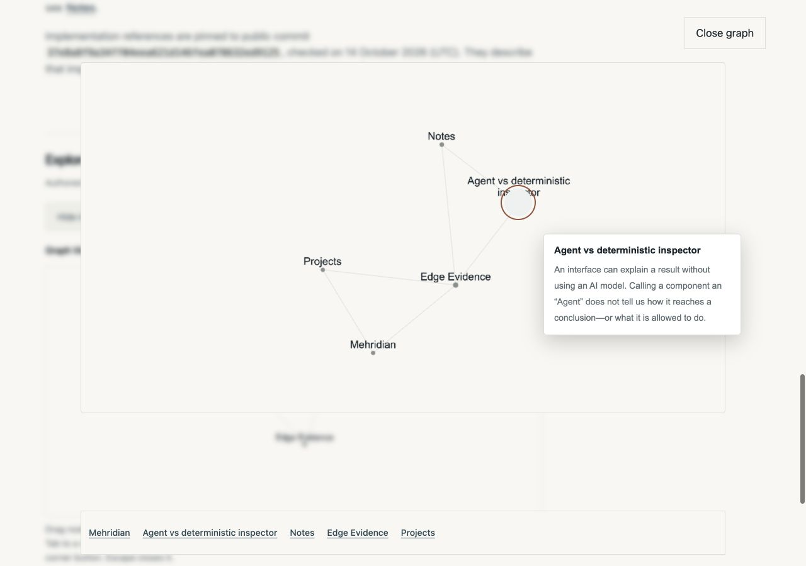
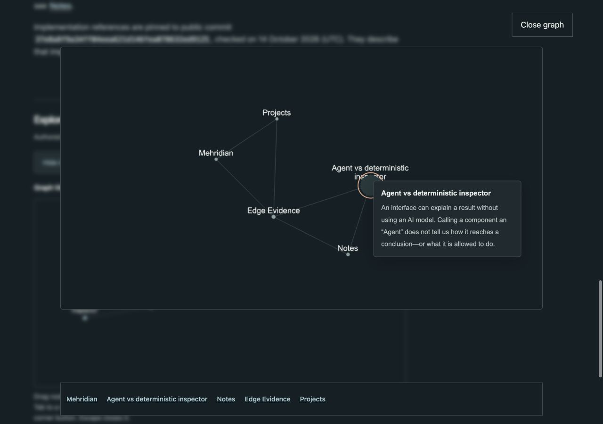
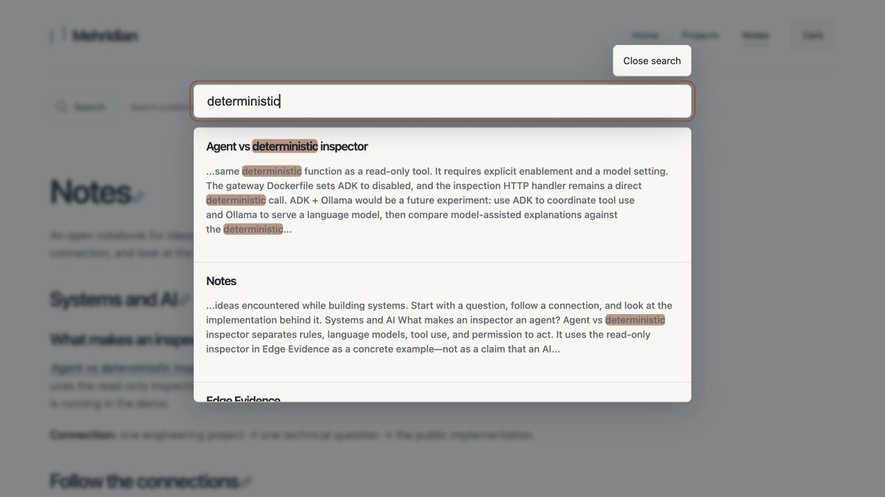
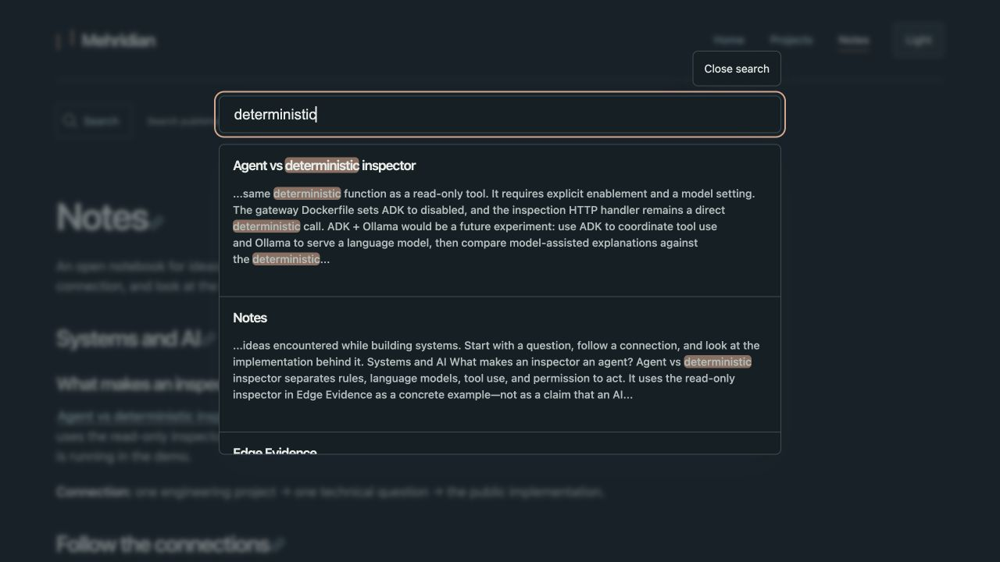

### Mobile

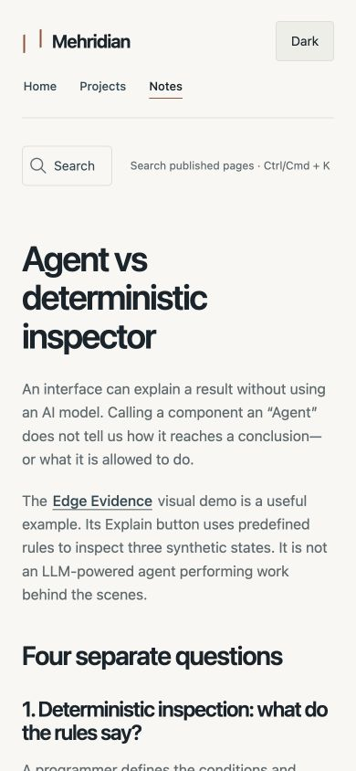
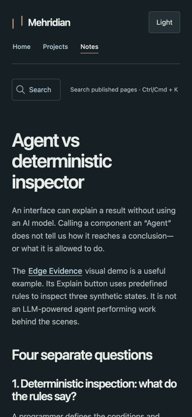
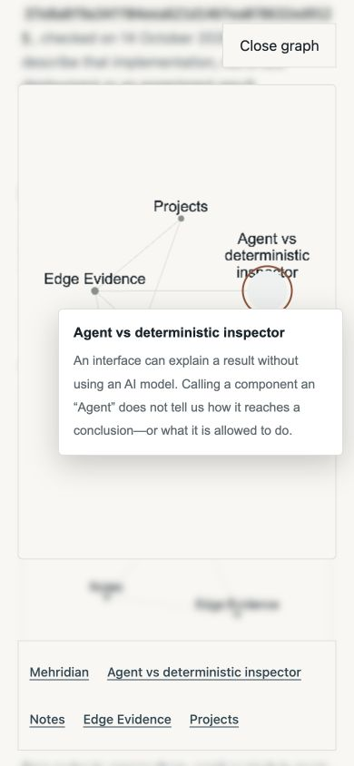
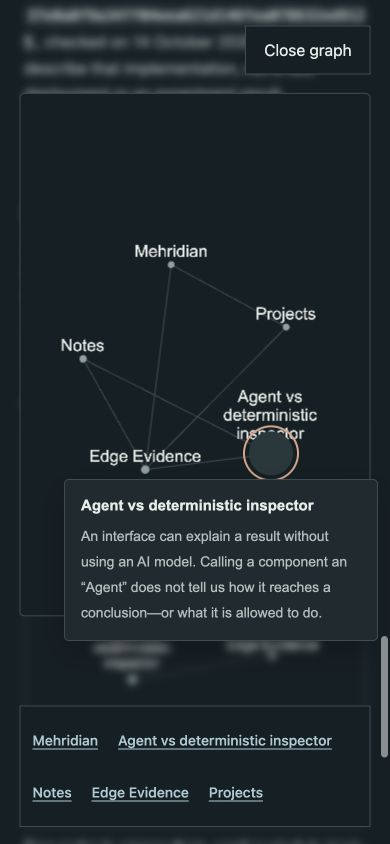
